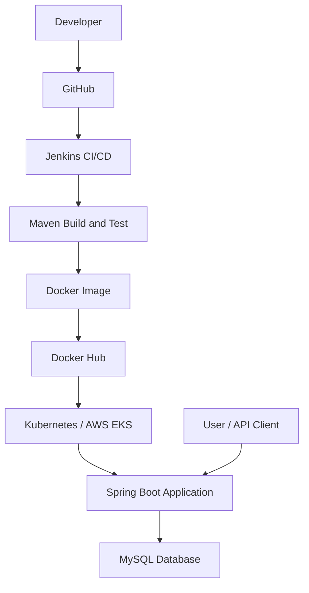

# 🚀 Employee Management System – DevOps Project

<p align="center">
  
  
  
  
  
  
  
</p>

---

## 📌 About the Project

The **Employee Management System** is a REST API application developed using Java 21 and Spring Boot with MySQL as the database.

This project demonstrates how to develop, containerize, build, and prepare an application for deployment using modern DevOps tools and practices.

It covers the DevOps workflow, including Git, Docker, Docker Hub, Jenkins CI/CD, Kubernetes and AWS EKS.

## ✨ Key Features

- Create new employee records.
- Retrieve all employees.
- Retrieve employee details by ID.
- Update existing employee information.
- Delete employee records.
- REST API development using Spring Boot.
- MySQL database integration.
- Docker containerization.
- Docker Compose for multi-container management.
- Docker Hub image publishing.
- Jenkins CI/CD pipeline configuration.
- Kubernetes deployment manifests.
- AWS EKS deployment instructions.

---

## 🏗️ Project Architecture



## 🛠️ Technology Stack

| Category | Technology |
|---|---|
| Programming Language | Java 21 |
| Backend Framework | Spring Boot 3.5.6 |
| Build Tool | Maven |
| Database | MySQL 8.4 |
| ORM | Spring Data JPA |
| API | REST API |
| Containerization | Docker |
| Container Management | Docker Compose |
| CI/CD | Jenkins |
| Container Registry | Docker Hub |
| Orchestration | Kubernetes |
| Cloud Platform | AWS EKS |
| Version Control | Git & GitHub |

---

## 📁 Project Structure

```text
employee-management-system-devops/
│
├── k8s/
│   ├── namespace.yaml
│   ├── configmap.yaml
│   ├── secret.yaml
│   ├── mysql-pvc.yaml
│   ├── mysql-deployment.yaml
│   ├── mysql-service.yaml
│   ├── deployment.yaml
│   ├── service.yaml
│   └── hpa.yaml
│
├── src/
│   └── main/
│
├── docker/
│
├── .dockerignore
├── .env.example
├── .gitignore
├── Dockerfile
├── docker-compose.yml
├── Jenkinsfile
├── pom.xml
└── README.md
```

---

## ⚙️ Prerequisites

Install the following tools:

- Java 21
- Maven 3.9+
- Git
- Docker Engine
- Docker Compose v2

For Kubernetes deployment:

- Kubernetes cluster
- kubectl
- StorageClass / Persistent Volume provisioner
- Metrics Server for Horizontal Pod Autoscaler

---

## 🚀 1. Run the Application Locally

### Step 1: Clone the repository

```bash
git clone https://github.com/Shatakshi033/employee-management-system-devops.git
```

```bash
cd employee-management-system-devops
```

### Step 2: Configure environment variables

Copy `.env.example` to `.env`.

For Windows PowerShell:

```powershell
Copy-Item .env.example .env
```

For Linux:

```bash
cp .env.example .env
```

Update the required database passwords in `.env`.

### Step 3: Build and start the application

```bash
docker compose up --build -d
```

### Step 4: Check running containers

```bash
docker compose ps
```

### Step 5: View application logs

```bash
docker compose logs -f app
```

### Application URLs

| Service | URL |
|---|---|
| Employee API | http://localhost:8081/api/employees |
| Health Check | http://localhost:8081/actuator/health |

### Stop the application

```bash
docker compose down
```

To remove containers and database volumes:

```bash
docker compose down -v
```

⚠️ **Warning:** The `-v` option removes database volume data. Use it carefully.

---

## 🔗 2. REST API Testing

The application supports CRUD operations.

### 1. Create Employee – POST

```bash
curl -X POST http://localhost:8081/api/employees -H "Content-Type: application/json" -d "{\"firstName\":\"Asha\",\"lastName\":\"Sharma\",\"email\":\"asha@example.com\",\"department\":\"Engineering\",\"salary\":65000}"
```

### 2. Get All Employees – GET

```bash
curl http://localhost:8081/api/employees
```

### 3. Get Employee by ID – GET

```bash
curl http://localhost:8081/api/employees/1
```

### 4. Update Employee – PUT

```bash
curl -X PUT http://localhost:8081/api/employees/1 -H "Content-Type: application/json" -d "{\"firstName\":\"Asha\",\"lastName\":\"Sharma\",\"email\":\"asha@example.com\",\"department\":\"Platform\",\"salary\":72000}"
```

### 5. Delete Employee – DELETE

```bash
curl -X DELETE http://localhost:8081/api/employees/1
```

---

## 🐳 3. Docker Containerization

Docker is used to package the Spring Boot application into a container image.

### Build Docker Image

```bash
docker build -t shatakshixcloud/employee-management:v1 .
```

### Login to Docker Hub

```bash
docker login
```

### Push Image to Docker Hub

```bash
docker push shatakshixcloud/employee-management:v1
```

### Pull Image from Docker Hub

```bash
docker pull shatakshixcloud/employee-management:v1
```

### Verify Docker Image

```bash
docker images
```

**Docker Hub:** https://hub.docker.com/

---

## 🔄 4. Jenkins CI/CD Pipeline

Jenkins is used to automate the application build, testing and deployment workflow.

### Required Jenkins Plugins

- Pipeline
- Git
- Credentials Binding

### Required Jenkins Credentials

| Credential ID | Credential Type | Purpose |
|---|---|---|
| `dockerhub-creds` | Username with password | Docker Hub authentication |
| `eks-kubeconfig` | Secret file | Kubernetes cluster access |

Use a Docker Hub access token as the password for Docker Hub credentials.

### CI/CD Workflow

1. Developer pushes code to GitHub.
2. Jenkins checks out the source code.
3. Maven builds the application.
4. Automated tests are executed.
5. Docker image is built.
6. Image is pushed to Docker Hub.
7. Kubernetes manifests are applied.
8. Application Deployment is updated.

### Jenkins Pipeline Setup

1. Open Jenkins dashboard.
2. Install the required plugins.
3. Configure Docker Hub credentials.
4. Configure Kubernetes kubeconfig credentials.
5. Create a new Pipeline job.
6. Select Pipeline script from SCM.
7. Connect the GitHub repository.
8. Set the script path to `Jenkinsfile`.

**Important:** The Jenkins agent needs Java 21, Maven, Docker CLI/daemon access and kubectl.

The current Jenkinsfile uses Linux shell commands (`sh`). If Jenkins is running as a Windows service, use a compatible Linux/WSL agent or adapt the commands before running the pipeline.

The Kubernetes deployment stage requires a configured cluster and suitable permissions.

---

## ☸️ 5. Kubernetes Deployment

Kubernetes manifests are provided in the `k8s/` directory.

### Before Deployment

- Update passwords in `k8s/secret.yaml`.
- Replace the Docker Hub image name in `k8s/deployment.yaml`.
- Ensure a default StorageClass exists, or configure `storageClassName` in the PVC manifest.
- Connect to a working Kubernetes cluster.

### Step 1: Check Kubernetes Nodes

```bash
kubectl get nodes
```

### Step 2: Create Namespace

```bash
kubectl apply -f k8s/namespace.yaml
```

### Step 3: Apply ConfigMap and Secrets

```bash
kubectl apply -n employee-system -f k8s/configmap.yaml
kubectl apply -n employee-system -f k8s/secret.yaml
```

### Step 4: Deploy MySQL

```bash
kubectl apply -n employee-system -f k8s/mysql-pvc.yaml
kubectl apply -n employee-system -f k8s/mysql-deployment.yaml
kubectl apply -n employee-system -f k8s/mysql-service.yaml
```

### Step 5: Deploy Employee Application

```bash
kubectl apply -n employee-system -f k8s/deployment.yaml
kubectl apply -n employee-system -f k8s/service.yaml
kubectl apply -n employee-system -f k8s/hpa.yaml
```

### Step 6: Verify Deployment

```bash
kubectl get all,pvc,hpa -n employee-system
```

```bash
kubectl rollout status deployment/employee-app -n employee-system
```

```bash
kubectl get svc employee-app -n employee-system
```

### Access the Application

When the LoadBalancer receives an external address:

```text
http://EXTERNAL_ADDRESS/api/employees
```

For Minikube:

```bash
minikube service employee-app -n employee-system
```

---

## ☁️ 6. AWS EKS Deployment

AWS Elastic Kubernetes Service (EKS) can be used to run the application on a managed Kubernetes cluster.

After creating an EKS cluster and node group, configure kubectl:

```bash
aws eks update-kubeconfig --region YOUR_AWS_REGION --name YOUR_EKS_CLUSTER
```

Verify cluster connectivity:

```bash
kubectl get nodes
```

Use a dedicated least-privilege IAM identity for Jenkins.

⚠️ **AWS Cost Warning:** LoadBalancer resources and running EKS infrastructure may incur AWS charges. Delete unused resources when finished.

---

## 🔐 7. Security and Production Improvements

This project is a DevOps learning project and is not yet a hardened production platform.

Recommended improvements:

- Never commit real passwords or secrets to GitHub.
- Use AWS Secrets Manager or External Secrets.
- Implement API authentication and authorization.
- Enable HTTPS.
- Use Flyway or Liquibase for database migrations.
- Configure regular database backups.
- Add monitoring and centralized logging.
- Scan and sign Docker images.
- Configure Kubernetes Network Policies.
- Follow least-privilege IAM and RBAC practices.
- Consider Amazon RDS for production database hosting.

---

## 📚 8. DevOps Concepts Covered

| DevOps Topic | Project Implementation |
|---|---|
| Linux | Command-line operations |
| Git | Source code version control |
| GitHub | Code repository |
| Maven | Application build |
| Docker | Containerization |
| Docker Compose | Multi-container management |
| Docker Hub | Image registry |
| Jenkins | CI/CD automation |
| Kubernetes | Container orchestration |
| ConfigMap | Application configuration |
| Secrets | Sensitive configuration |
| PVC | Persistent storage |
| HPA | Application autoscaling |
| AWS EKS | Managed Kubernetes |

---

## 🎯 9. Learning Outcomes

Through this project, I practiced:

- Building a Java Spring Boot REST API.
- Integrating a backend application with MySQL.
- Performing CRUD operations.
- Creating Docker images and containers.
- Managing multi-container applications with Docker Compose.
- Publishing Docker images to Docker Hub.
- Understanding Jenkins CI/CD pipelines.
- Preparing Kubernetes deployment manifests.
- Learning AWS EKS deployment workflows.
- Understanding real-world DevOps practices.

---

## 👩‍💻 Author

**Shatakshi Sinha**

GitHub: [Shatakshi033](https://github.com/Shatakshi033)

Project Repository: [Employee Management System – DevOps](https://github.com/Shatakshi033/employee-management-system-devops)

---

<p align="center">
  ⭐ If you find this project useful, consider giving it a star!
</p>
